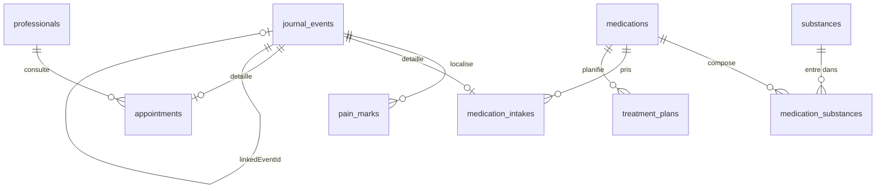
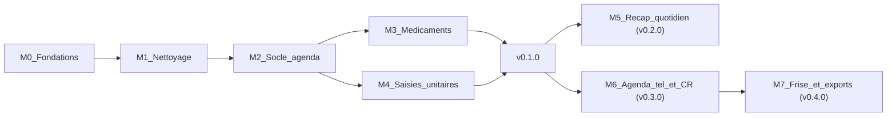

# Endoluteal : roadmap et découpage en issues

Endoluteal est un hard-fork de [Luteal](https://github.com/JoeriKaiser/luteal) qui transforme un suivi de cycle en **agenda de suivi de l'endométriose** : prises de médicaments, douleurs localisées, traitements non médicamenteux, rendez-vous médicaux, hospitalisations et récap quotidien.

Ce document est la source de vérité du découpage. Les issues GitHub sont générées depuis la section [Issues](#issues) par [`scripts/create-issues.py`](../../scripts/create-issues.py).

## Principes

- **Livrer tôt, sur un vrai téléphone.** Chaque milestone produit un APK installable via Obtainium. La v0.1.0 est la première installation réelle.
- **Soustraire avant d'ajouter.** Le nettoyage (M1) réduit la base de code de moitié avant d'y construire quoi que ce soit, ce qui réduit aussi le contexte des agents.
- **Une issue = une PR atomique**, en Conventional Commits, avec `Closes #n` et ses tests.
- **Données de santé : rien ne sort de l'appareil**, sauf l'aide au CR des rendez-vous via OpenRouter (audio / transcript envoyés sur action explicite avec la clé de l'utilisatrice). Permission `INTERNET` limitée à ce flux.
- **Enregistré vs estimé** (héritage Luteal) : ce que l'utilisatrice a saisi n'est jamais présenté comme ce que l'app a calculé.
- **Aide, pas avis médical.** Les alertes médicamenteuses assistent, elles ne remplacent ni médecin ni pharmacien.

## Décisions d'architecture

### Identité

- `applicationId` : `io.github.thomasdelorge.endoluteal`, avec un suffixe `.dev` en debug pour installer debug et release côte à côte.
- Les packages Kotlin `fr.luteal.*` sont conservés : un renommage coûterait un diff énorme sans valeur fonctionnelle.
- Aucune compatibilité avec les données Luteal : l'app s'installe à côté, et on part de zéro.

### Persistance

- Room repart en **v1** et le format de backup passe en `endoluteal/v1`.
- Tant que la v0.1.0 n'est pas installée chez l'utilisatrice, les changements de schéma peuvent être destructifs. **À partir de la v0.1.0, toute évolution de schéma exige une migration testée** (`MigrationTestHelper`).
- Toute nouvelle table doit être couverte par l'export/import JSON, donc par le backup automatique.

### Modèle d'événements hybride

- `journal_events` porte les colonnes communes : `id`, `type`, `startAt`, `endAt`, `notes`, `linkedEventId`, `payloadJson`. Le payload est une sealed class sérialisée avec kotlinx.serialization. L'agenda et la frise lisent une seule table.
- Des tables normalisées existent uniquement là où l'on agrège : `medication_intakes` (cumul des doses), `pain_marks` (heatmap), `appointments` + `professionals` (filtres de la frise).
- Le moteur de cycle existant (`DailyEntry`, `Cycle`, `CurrentCyclePhaseCalculator`) reste la source des règles et de la phase estimée.

### Rappels

- Un `ReminderScheduler` unique, persistant en base, basé sur `AlarmManager` exact (`USE_EXACT_ALARM`, acceptable hors Play Store).
- Un canal de notification par type de rappel. Actions : Pris, +10 min, +30 min, +1 h, Ignorer.
- Replanification au reboot et au changement d'heure, sur le patron existant de `NotificationSystemReceiver`.

### Navigation cible

Barre du bas : **Agenda** (accueil : calendrier + FAB speed dial), **Frise**, **Médicaments**, **Réglages**. L'écran Aujourd'hui, les conseils de phase et « Le saviez-vous » disparaissent.

### Langue

Français uniquement.

## Développement local

Voir la section « Développement » du [README](../../README.md). Les points à retenir :

- JDK 21 et SDK Android via mise (`android-sdk 13.0`). AGP télécharge lui-même `platforms;android-37.0` au premier build.
- AVD dédié `endoluteal_api35` (Pixel 8, API 35, sans écran de verrouillage).
- Commandes de vérification de chaque PR : `./gradlew assembleDebug lintDebug testDebugUnitTest`.

## Distribution

- Un tag `vX.Y.Z` déclenche le workflow de release, qui publie `endoluteal-vX.Y.Z.apk` signé dans les GitHub Releases.
- Obtainium suit les releases du dépôt `thomasdelorge/Endoluteal`.
- La clé de signature est unique et définitive : la perdre empêche toute mise à jour sans désinstallation, donc sans perte de données.

## Milestones

- **M0 Fondations** : identité, environnement de dev, CI/CD, règles pour agents.
- **M1 Nettoyage** : retrait de Duo, du sync, des widgets, d'Aujourd'hui, des biomarqueurs inutiles ; reset du schéma ; FR uniquement.
- **M2 Socle agenda** : modèle d'événements, référentiels douleur, composants `PainScale` et `BodyMap`, écran Agenda, rappels.
- **M3 Médicaments** : base de médicaments, alertes, prises ponctuelles, plans récurrents, backup automatique.
- **M4 Saisies unitaires** : symptôme, traitement non médicamenteux, hospitalisation, RDV manuel.
- **v0.1.0** : première installation réelle. Migrations obligatoires ensuite.
- **M5 Récap quotidien (v0.2.0)** : wizard en cartes, 5D, EHP-5, backup chiffré.
- **M6 Agenda téléphone et CR (v0.3.0)** : import des RDV depuis l'agenda, comptes rendus.
- **M7 Frise et exports (v0.4.0)** : frise chronologique, état des lieux par praticien, PDF.
- **Backlog** : transcription audio locale, Nextcloud, analyses, widget.

## Conventions des issues

- **Labels** : `type:feat|refactor|chore|ci|docs`, `area:build|cleanup|db|ui|agenda|meds|notif|recap|calendar|reports|backup`, `size:S|M|L`, `agent-ready`, `later`.
- **Tailles** : S (moins d'une demi-journée d'agent), M (une journée), L (plusieurs jours, à découper si possible).
- **Corps** : Contexte, Objectif, Hors périmètre, Fichiers pressentis, Critères d'acceptation, Vérification, Dépend de.
- **Références** : `[F1]` désigne une autre issue de ce document ; le script la remplace par son numéro GitHub.
- **Branches** : `feat/<n>-<slug>`, `refactor/<n>-<slug>`, etc. PR vers `main` de `thomasdelorge/Endoluteal` (jamais vers l'upstream).
- **Vérification commune** : `./gradlew assembleDebug lintDebug testDebugUnitTest` passe, et le scénario manuel décrit est rejoué sur l'émulateur.

## Décisions validées

- Cycle : on garde règles, phase estimée et glaire ; on retire température, LH/hCG et les vues Thermique, Variabilité et Tendances.
- Données : départ de zéro, schéma v1.
- Accueil : Agenda ; Aujourd'hui est supprimé.
- Langue : FR uniquement.
- BodyMap : pins sur silhouette CHOIR (plusieurs par zone), clé de zone pour l’agrégation ; voir [PAIN_BODY_MAP.md](../architecture/PAIN_BODY_MAP.md).
- Base médicaments : pré-remplissage optionnel des antalgiques courants, doses à valider, avertissement permanent.
- TENS généralisé en traitement non médicamenteux.
- 5D de l'endométriose dans le récap, dyspareunie masquable.
- Impact sur la journée dans le récap.
- Questionnaire mensuel inspiré (pas le texte EHP-5) tant qu’aucun accord Oxford n’est obtenu : [EHP5_LICENCE.md](EHP5_LICENCE.md).
- Traitement hormonal continu : masque la prédiction des règles.
- Widgets supprimés ; widget de prise rapide en backlog.
- Backup chiffré en v0.2.0.

## Issues

### F1 · chore: identité du hard-fork Endoluteal
> milestone: M0 Fondations | labels: type:chore,area:build,size:S,agent-ready

**Contexte**
Le fork porte encore l'identité Luteal : `applicationId` `fr.luteal.app`, nom « Luteal », version 1.8.0. Les rapports de crash ACRA partent par mail vers l'auteur upstream (`LutealApp.kt` L59).

**Objectif**
- `applicationId = "io.github.thomasdelorge.endoluteal"`, et `applicationIdSuffix = ".dev"` sur le build type debug.
- `versionCode = 1`, `versionName = "0.1.0-dev"`.
- `app_name` = « Endoluteal » (release) et « Endoluteal Dev » (debug, `app/src/debug/res/values*/strings.xml`).
- `rootProject.name = "endoluteal"` dans `settings.gradle.kts`.
- Destinataire ACRA `mailTo` remplacé par l'adresse du mainteneur du fork (à demander au mainteneur ; ne pas laisser l'adresse upstream).
- Icône de lanceur teintée (couleur de fond différente de Luteal) pour distinguer les deux apps sur un même téléphone.

**Hors périmètre**
Renommage des packages Kotlin `fr.luteal.*`. Thème global de l'app.

**Fichiers pressentis**
`app/build.gradle.kts`, `settings.gradle.kts`, `app/src/main/res/values*/strings.xml`, `app/src/debug/res/values*/strings.xml`, `app/src/main/java/fr/luteal/app/LutealApp.kt`, `app/src/main/res/drawable*/ic_launcher_background*`, `app/src/main/res/values/colors.xml` ou équivalent.

**Critères d'acceptation**
- [ ] Debug et release s'installent côte à côte sur le même appareil, et à côté de Luteal.
- [ ] `rg "joeri" app/` ne renvoie rien.
- [ ] L'icône est visuellement distincte de celle de Luteal.

**Vérification**
`./gradlew assembleDebug lintDebug testDebugUnitTest`, puis `adb shell pm list packages | grep endoluteal` après `installDebug`.

**Dépend de**
Rien.

### F2 · chore(dev): environnement local reproductible (mise, Makefile, émulateur)
> milestone: M0 Fondations | labels: type:chore,area:build,size:S,agent-ready

**Contexte**
L'environnement existe sur la machine du mainteneur (SDK via mise, AVD `endoluteal_api35`), mais rien ne le décrit dans le dépôt. La cible `dev-install` du Makefile référence un `fr.luteal.app.dev` qui n'existe pas.

**Objectif**
- `mise.toml` à la racine : `java = "temurin-21"`, `android-sdk = "13.0"`, avec `ANDROID_HOME` exporté.
- Cibles Makefile :
  - `emu` : lance l'AVD `$(AVD)` (défaut `endoluteal_api35`) avec `-gpu host`.
  - `run` : `installDebug` puis `adb shell am start -n $(APP_ID_DEV)/fr.luteal.app.MainActivity`.
  - `logcat` : `adb logcat --pid=$$(adb shell pidof -s $(APP_ID_DEV))`.
  - `avd` : crée l'AVD s'il n'existe pas (`avdmanager create avd -n endoluteal_api35 -k "system-images;android-35;google_apis;x86_64" -d pixel_8`).
- Correction de `dev-install` avec le bon identifiant (dépend de [F1]).
- Section « Développement » du README mise à jour (émulateur, appareil physique via `adb pair` en débogage sans fil).

**Hors périmètre**
Android Studio, configuration IDE.

**Fichiers pressentis**
`mise.toml`, `Makefile`, `README.md`.

**Critères d'acceptation**
- [ ] Sur une machine avec mise : `mise install && make avd emu run` affiche l'app sur l'émulateur.
- [ ] `make logcat` n'affiche que les logs de l'app.

**Vérification**
Rejouer la séquence ci-dessus depuis un clone propre.

**Dépend de**
[F1]

### F3 · ci: publication des APK signés dans les GitHub Releases pour Obtainium
> milestone: M0 Fondations | labels: type:ci,area:build,size:M,agent-ready

**Contexte**
`.github/workflows/release.yml` publie `luteal-vX.apk` sur tag `v*`, avec signature via 4 secrets. `build.yml` compile et teste sur les PR sans publier d'APK. Il n'existe pas de `CHANGELOG.md` à la racine (les changelogs sont dans `fastlane/`).

**Objectif**
- `release.yml` :
  - échoue si le tag `vX.Y.Z` ne correspond pas à `versionName` dans `app/build.gradle.kts` ;
  - publie `dist/endoluteal-vX.Y.Z.apk` et un fichier `.sha256` ;
  - utilise comme corps de release la section `[X.Y.Z]` de `CHANGELOG.md` (extraction awk) au lieu de `generate_release_notes` ;
  - marque en pré-release les tags contenant un suffixe (`v0.2.0-rc.1`).
- `build.yml` : upload de `app-debug.apk` en artefact (rétention 7 jours) pour tester une PR sans la compiler.
- `CHANGELOG.md` au format Keep a Changelog, avec `[Unreleased]` en tête.
- Section README « Installer avec Obtainium » : URL du dépôt et filtre d'APK `endoluteal-v.*\.apk`.
- Section README « Signature » pour le mainteneur : génération du keystore (`keytool -genkeypair -v -keystore endoluteal-release.jks -alias endoluteal -keyalg RSA -keysize 4096 -validity 10000`), encodage base64, `gh secret set` des 4 secrets, sauvegarde hors dépôt du keystore.

**Hors périmètre**
Publication F-Droid ou Play Store. Calcul automatique du `versionCode` depuis le tag.

**Fichiers pressentis**
`.github/workflows/release.yml`, `.github/workflows/build.yml`, `CHANGELOG.md`, `README.md`, `Makefile` (cible `release-build` : nom d'APK).

**Critères d'acceptation**
- [ ] Un tag `v0.0.1-rc.1` poussé produit une pré-release avec l'APK signé et son sha256.
- [ ] Un tag incohérent avec `versionName` fait échouer le workflow avec un message explicite.
- [ ] Obtainium détecte la release et installe l'APK.
- [ ] Une PR expose l'APK debug en artefact.

**Vérification**
Pousser un tag de pré-release sur une branche de test, vérifier `apksigner verify --print-certs` dans les logs, puis ajouter l'app dans Obtainium.

**Dépend de**
[F1]. Action manuelle du mainteneur : créer le keystore et les secrets `RELEASE_KEYSTORE_BASE64`, `KEYSTORE_PASSWORD`, `KEY_ALIAS`, `KEY_PASSWORD`.

### F4 · docs: AGENTS.md avec les invariants du projet
> milestone: M0 Fondations | labels: type:docs,area:build,size:S,agent-ready

**Contexte**
Le développement se fait par agents. Sans règles écrites, chaque agent redécouvre les conventions. `AGENTS.md` est actuellement listé dans `.gitignore`.

**Objectif**
- Retirer `AGENTS.md` du `.gitignore`.
- Créer `AGENTS.md` (court, moins de 100 lignes) :
  - pitch du projet et lien vers cette roadmap ;
  - architecture (Hilt, Compose, StateFlow, Room, modèle `journal_events`) ;
  - invariants : pas de permission `INTERNET` ; enregistré vs estimé ; migrations Room obligatoires à partir de la v0.1.0 ; toute nouvelle table couverte par l'export/import ; chaînes en français dans `values/strings.xml` ; alertes médicamenteuses présentées comme une aide ;
  - commandes : `./gradlew assembleDebug lintDebug testDebugUnitTest`, `make run`, `make logcat` ;
  - conventions : Conventional Commits, une issue par PR, `Closes #n`, PR vers `thomasdelorge/Endoluteal` ;
  - définition de « terminé » : critères d'acceptation cochés, tests ajoutés pour toute logique non triviale, scénario rejoué sur émulateur, entrée dans `CHANGELOG.md` sous `[Unreleased]`.

**Hors périmètre**
Règles Cursor spécifiques (`.cursor/rules`).

**Fichiers pressentis**
`AGENTS.md`, `.gitignore`.

**Critères d'acceptation**
- [ ] `AGENTS.md` est versionné et liste tous les invariants ci-dessus.

**Vérification**
Relecture.

**Dépend de**
Rien.

### C1 · refactor: retirer le mode Duo et tous les widgets
> milestone: M1 Nettoyage | labels: type:refactor,area:cleanup,size:M,agent-ready

**Contexte**
Le mode Duo (partage avec un partenaire) et les widgets d'écran d'accueil (Glance) ne servent pas la cible. Le widget de prise rapide sera réintroduit plus tard ([L4]).

**Objectif**
Supprimer :
- `DuoScreen.kt`, `DuoViewModel.kt`, l'onglet `DUO` de `LutealDestination` et le deep link widget dans `LutealMainScaffold.kt` ;
- le choix de rôle partenaire dans `OnboardingScreen.kt` ; `UserRole.PARTNER_VIEWER` ;
- `DuoSharingPreferences`, `DuoProjection`, `CachedDuoCycleProjection`, `CouplePairing`, `QuickSupportNudge`, `PartnerPhaseGuidance` et leurs clés DataStore ;
- `DuoRepository`, `DuoCycleProjectionCacheWriter`, `DuoWidgetCacheRepository` ;
- tout le package `fr.luteal.app.widget` (perso et Duo), ses receivers du manifest, `res/xml/*_widget_info.xml`, `res/layout/widget_*`, la dépendance Glance et `glance-testing` ;
- les chaînes `duo_*`, `partner_tip_*`, `widget_*` ;
- les tests associés (`DuoSharingPreferencesTest`, `PartnerPhaseGuidanceTest`, `WidgetContentTest`, `WidgetProviderInfoTest`, partie Duo de `LutealScreensTest`).

Les entités Room `DuoWidgetCacheEntity` / `DuoWidgetCacheDao` restent déclarées dans `LutealDatabase` jusqu'à [C4], qui réinitialise le schéma. Elles ne sont simplement plus utilisées.

**Hors périmètre**
Le sync et le client API folicular ([C2]), y compris les méthodes Duo de `FolicularApiClient` si leur retrait casse la compilation du sync (dans ce cas, les laisser pour [C2]).

**Fichiers pressentis**
Voir la liste ci-dessus ; `rg -il "duo|partner|glance|widget" app/src` donne l'inventaire.

**Critères d'acceptation**
- [ ] `rg -i "duo|glance" app/src/main` ne renvoie que les entités Room en attente de [C4] et le code sync en attente de [C2].
- [ ] La barre du bas n'affiche plus Duo.
- [ ] L'onboarding ne propose plus de rôle partenaire.

**Vérification**
Commandes communes, puis onboarding complet et navigation dans tous les onglets sur l'émulateur.

**Dépend de**
[F1]

### C2 · refactor: retirer la synchronisation en ligne et la crypto E2EE
> milestone: M1 Nettoyage | labels: type:refactor,area:cleanup,size:L,agent-ready

**Contexte**
Le sync vers le backend folicular représente le plus gros bloc de code : réseau OkHttp, crypto, contrat OpenAPI généré, workers, credentials. Endoluteal ne doit jamais faire sortir de données de l'appareil.

**Objectif**
Supprimer :
- le package `fr.luteal.core.network` en entier (client, wire, sync engine, mapping, crypto, auth) ;
- `SyncModule.kt`, `SyncWorker`, `SyncScheduler`, `SyncDataStore`, `SyncMode`, `SyncStatus` ;
- `SyncCard`, la carte de code de compte et la récupération de compte dans `SettingsScreen.kt` / `SettingsViewModel.kt` ;
- les appels `markDirty` / `SyncRevisionClock` dans `CycleRepositoryImpl`, `DailyEntryRepositoryImpl`, `BiomarkerRepositoryImpl`, `SymptomRepositoryImpl`, `DataImportManager`, `TestDataSeeder` (les écritures Room restent identiques) ;
- les branches sync de `LocalDataPurgeManager` ;
- côté build : plugin `openapi.generator`, tâche `openApiGenerate` et son branchement `preBuild`, dépendance OkHttp et MockWebServer, `buildConfigField SYNC_BASE_URL`, propriétés de test `folicular.*` ;
- côté manifest : `INTERNET`, `ACCESS_NETWORK_STATE`, `app/src/debug/AndroidManifest.xml` cleartext, `network_security_config.xml` ;
- le répertoire `contract/` et `scripts/sync-contract.sh` ;
- les tests de `app/src/test/java/fr/luteal/core/network/**`, `SyncWorkerTest`, et les assertions sync de `CycleRepositoryTest`, `DailyEntryRepositoryTest`, `DataImportManagerTest`.

À conserver : WorkManager et `hilt-work` (nécessaires à [D6] et [A1]), le verrou PIN (`fr.luteal.core.data.security`). Vérifier que `KeystoreSecretStore` n'est pas utilisé par le verrou avant de le supprimer.

Les entités `SyncStateEntity` / `SyncStateDao` restent déclarées jusqu'à [C4].

**Hors périmètre**
Reset du schéma ([C4]). Nettoyage des docs ([C5]).

**Fichiers pressentis**
Voir l'objectif ; `rg -il "sync|folicular|okhttp|RecordCrypto" app/ gradle/` donne l'inventaire.

**Critères d'acceptation**
- [ ] `aapt dump permissions` sur l'APK release ne liste ni `INTERNET` ni `ACCESS_NETWORK_STATE`.
- [ ] `rg -i "folicular|okhttp|SYNC_BASE_URL" app/ gradle/` ne renvoie rien.
- [ ] Créer, modifier et supprimer une observation fonctionne comme avant.
- [ ] Export, import et purge des données fonctionnent.

**Vérification**
Commandes communes, `./gradlew assembleRelease` (sans signature), puis saisie d'une observation, export JSON, purge et réimport sur l'émulateur.

**Dépend de**
[C1]

### C3 · refactor: retirer Aujourd'hui, les conseils, les biomarqueurs et les vues d'analyse de cycle
> milestone: M1 Nettoyage | labels: type:refactor,area:cleanup,size:M,agent-ready

**Contexte**
L'accueil deviendra l'Agenda ([S5]). On garde du moteur de cycle les règles, la phase estimée et la glaire cervicale (qui alimentera les « pertes blanches » du récap).

**Objectif**
Supprimer :
- `TodayScreen.kt` et l'onglet `TODAY`. Le Journal devient l'onglet par défaut jusqu'à [S5]. Le démarrage des règles reste possible via la feuille de saisie (`startsNewCycle`) ;
- « Le saviez-vous » : `CycleFact.kt`, chaînes `fact_*`, `CycleFactsTest` ;
- conseils de phase : `PhaseTip.kt`, chaînes `phase_tip_*`, `PhaseTipsTest`, et `ClinicalSources.kt` s'il n'a plus d'usage ;
- biomarqueurs température basale, perturbations, tests LH/hCG dans `BiomarkerObservation` et l'UI de saisie ; préférence `temperatureUnit` ;
- `ThermalShiftCalculator` et les vues `THERMAL`, `VARIABILITY`, `PATTERNS` de `JournalScreen` (`CycleVariabilityVisualizer.kt`, `SymptomPatternCalculator.kt`, `LongitudinalCycleStatsCalculator.kt` si plus utilisés, y compris par le rapport clinique) ;
- les biomarqueurs correspondants dans `scripts/seed-release.sh`.

À conserver : sensation et texture de la glaire cervicale, `CurrentCyclePhaseCalculator`, `CycleEstimateCalculator`, `MonthCalendarGrid`, vues `CALENDAR` et `TIMELINE`.

**Hors périmètre**
Refonte de la saisie quotidienne ([R1]). Reset du schéma ([C4]) : les colonnes inutilisées peuvent rester jusque-là.

**Fichiers pressentis**
`TodayScreen.kt`, `LutealMainScaffold.kt`, `JournalScreen.kt`, `DailyEntrySheet.kt`, `BiomarkerObservation.kt`, `UserPreferencesDataStore.kt`, `fr/luteal/core/model/*`, tests associés.

**Critères d'acceptation**
- [ ] L'app démarre sur le Journal (vue calendrier).
- [ ] La saisie d'un jour propose saignement, glaire, symptômes, notes, sans température ni test LH.
- [ ] La phase estimée et la fenêtre des prochaines règles s'affichent toujours dans le calendrier.

**Vérification**
Commandes communes, puis saisie de 2 cycles de test (réglage « données de test ») et contrôle du calendrier.

**Dépend de**
[C2]

### C4 · refactor(db): réinitialiser le schéma Room en v1 et le format de backup
> milestone: M1 Nettoyage | labels: type:refactor,area:db,size:M,agent-ready

**Contexte**
On part de zéro, sans données Luteal à migrer. Les 9 versions de schéma, les migrations manuelles et les tables sync/duo/legacy sont du poids mort.

**Objectif**
- `LutealDatabase` en `version = 1`, nom de fichier `endoluteal.db`. Suppression de `MIGRATION_1_2` à `MIGRATION_8_9` et des JSON `app/schemas/.../1.json` à `9.json`, puis régénération de `1.json`.
- Suppression des entités et DAO : `SyncStateEntity`, `CycleSyncStateEntity`, `DuoWidgetCacheEntity`, `DisorderConfigEntity`, `UserProfileEntity` (si elle ne porte plus que du sync/pairing), colonnes de biomarqueurs retirées en [C3], drapeaux sync des entités restantes.
- Format de backup `endoluteal/v1` (`LutealBackupPayload`) : un import d'un fichier Luteal ou d'un format inconnu est refusé avec un message clair.
- Conserver le harnais de test de migration (`RoomSchemaHarnessTest`, `LutealDatabaseMigrationTest`) en l'adaptant à la v1, prêt pour la première migration post-0.1.0.

**Hors périmètre**
Nouvelles tables (à partir de [S1]).

**Fichiers pressentis**
`fr/luteal/core/data/local/*`, `fr/luteal/core/data/entity/*`, `DatabaseModule.kt`, `LutealBackupPayload.kt`, `DataExportManager.kt`, `DataImportManager.kt`, `app/schemas/`, tests de migration et d'import.

**Critères d'acceptation**
- [ ] `app/schemas/` ne contient que `1.json`.
- [ ] Un export suivi d'un import `REPLACE_ALL` restitue les mêmes données (test unitaire).
- [ ] Un backup Luteal est refusé avec un message explicite.

**Vérification**
Commandes communes, `./gradlew connectedDebugAndroidTest` sur l'émulateur pour les tests de schéma.

**Dépend de**
[C1], [C2], [C3]

### C5 · chore: nettoyer docs upstream, métadonnées F-Droid et ressources orphelines
> milestone: M1 Nettoyage | labels: type:chore,area:cleanup,size:S,agent-ready

**Contexte**
Après [C1] à [C4], une partie de la documentation et des ressources décrit des fonctionnalités disparues.

**Objectif**
- Supprimer `docs/architecture/` (sync, E2EE, backend), `docs/product/ROADMAP.md`, `docs/product/HOME_SCREEN_WIDGETS.md`, `docs/product/CYCLE_TRACKER_FEATURE_RESEARCH.md`, `docs/research/PHASE_GUIDANCE_CATALOG.md`.
- Conserver `docs/research/CONDITION_CYCLE_IMPACTS.md` et `SOURCE_REGISTER.md` (utiles pour l'endométriose).
- Supprimer `fastlane/` et le bloc F-Droid de la cible `release-check` du Makefile.
- Supprimer les ressources inutilisées signalées par `lintDebug` (`UnusedResources`).

**Hors périmètre**
Traduction ([C6]).

**Fichiers pressentis**
`docs/`, `fastlane/`, `Makefile`, `app/src/main/res/`.

**Critères d'acceptation**
- [ ] `./gradlew lintDebug` ne signale plus de `UnusedResources`.
- [ ] Aucun lien mort dans le README.

**Vérification**
Commandes communes.

**Dépend de**
[C4]

### C6 · chore(i18n): passer l'application en français uniquement
> milestone: M1 Nettoyage | labels: type:chore,area:cleanup,size:S,agent-ready

**Contexte**
L'app est FR + EN. Maintenir deux langues double le travail sur chaque chaîne pour un usage francophone.

**Objectif**
- Le contenu de `values-fr/strings.xml` remplace `values/strings.xml`, et `values-fr/` est supprimé (idem pour `app/src/debug/res/`).
- `localeFilters` = `fr` uniquement ; `res/xml/locales_config.xml` et `android:localeConfig` alignés ou retirés.
- Rapport clinique : suppression du choix de langue (`ClinicalReportConfig`).
- Dialogue de consentement ACRA en français.

**Hors périmètre**
Réécriture des textes.

**Fichiers pressentis**
`app/src/main/res/values*/`, `app/src/debug/res/values*/`, `app/build.gradle.kts`, `AndroidManifest.xml`, `ClinicalReport*.kt`.

**Critères d'acceptation**
- [ ] L'app est en français sur un émulateur configuré en anglais.
- [ ] Il n'existe plus aucun dossier `values-fr`.

**Vérification**
Commandes communes, puis lancement sur l'émulateur en locale anglaise.

**Dépend de**
[C5]

### S1 · feat(domain): modèle d'événements journal_events et pain_marks
> milestone: M2 Socle agenda | labels: type:feat,area:db,size:M,agent-ready

**Contexte**
Toutes les saisies (prise, symptôme, traitement, RDV, hospitalisation, contrôle de douleur) sont des événements datés. L'agenda et la frise doivent les lire d'une seule requête.

**Objectif**
- Enum `JournalEventType` : `MEDICATION_INTAKE`, `PAIN_CHECK`, `SYMPTOM`, `CARE_SESSION`, `HOSPITALIZATION`, `APPOINTMENT`.
- Entité `journal_events` : `id` (UUID), `type`, `startAt` (epoch ms), `endAt` (nullable), `zoneId` (fuseau de saisie), `notes`, `linkedEventId` (nullable), `payloadJson`, `createdAt`, `updatedAt`. Index sur `startAt` et `type`.
- `sealed interface EventPayload` `@Serializable`, avec une sous-classe par type (vide ou minimale ; complétée par les issues de saisie).
- Entité `pain_marks` : `id`, `eventId` (FK, cascade), `zone` (id stable de zone, string), `intensity` (0-10), `painTypes` (liste d'ids, JSON).
- DAO : `observeBetween(from, to)`, `observeByType`, `get`, `upsert` (événement + marques en transaction), `delete`.
- `JournalEventRepository` (interface + impl + binding Hilt).
- Export/import JSON étendus aux deux tables.

**Hors périmètre**
Référentiels de zones et de types ([S2]), UI.

**Fichiers pressentis**
`fr/luteal/core/model/JournalEvent*.kt`, `fr/luteal/core/data/entity/`, `fr/luteal/core/data/local/`, `fr/luteal/core/data/repository/`, `RepositoryModule.kt`, `LutealBackupPayload.kt`, `DataExportManager.kt`, `DataImportManager.kt`.

**Critères d'acceptation**
- [ ] Test Robolectric : insertion d'un événement avec 3 marques, lecture par plage, suppression en cascade.
- [ ] Test : sérialisation aller-retour de chaque sous-type de payload.
- [ ] Test : export puis import restitue événements et marques.

**Vérification**
Commandes communes.

**Dépend de**
[C4]

### S2 · feat(ref): référentiels des zones corporelles et des types de douleur
> milestone: M2 Socle agenda | labels: type:feat,area:ui,size:S,agent-ready

**Contexte**
Localisation et type de douleur sont communs à toutes les saisies. Clés de zone CHOIR stables + coordonnées de pin pour la heatmap ; voir [PAIN_BODY_MAP.md](../architecture/PAIN_BODY_MAP.md).

**Objectif**
- Enum `BodyZone` (id stable, face `FRONT` / `BACK` / `INTERNAL`, libellé) :
  - face avant : tête, cou, poitrine G/D, épigastre, hypochondre G/D, flanc G/D, région péri-ombilicale, fosse iliaque G/D, hypogastre (sus-pubien), pli inguinal G/D, vulve/périnée, cuisse antérieure G/D, genou G/D, jambe G/D ;
  - face arrière : nuque, épaule G/D, dos haut, lombaire G/D, sacrum, coccyx, fesse G/D, cuisse postérieure G/D, mollet G/D ;
  - interne (non dessinée, saisie par puces) : vagin profond, rectum, vessie, ovaire G/D.
- Enum `PainType` (vocabulaire sensoriel du QDSA, version française du McGill, complété du vocabulaire courant) : élancements, lancinante, pénétrante, décharges électriques, coups de poignard, en étau, crampe, torsion, pinçante, tiraillement, brûlure, picotements, fourmillements, engourdissement, lourdeur, pesanteur pelvienne, sourde.
- Libellés dans `strings.xml`.

**Hors périmètre**
Géométrie et dessin ([S4]).

**Fichiers pressentis**
`fr/luteal/core/model/BodyZone.kt`, `fr/luteal/core/model/PainType.kt`, `res/values/strings.xml`.

**Critères d'acceptation**
- [ ] Ids uniques et stables (test).
- [ ] Chaque valeur a un libellé (test).

**Vérification**
Commandes communes.

**Dépend de**
[C6]

### S3 · feat(ui): composant PainScale 0-10
> milestone: M2 Socle agenda | labels: type:feat,area:ui,size:S,agent-ready

**Contexte**
L'échelle numérique 0-10 est le standard clinique de cotation de la douleur. Elle est utilisée par toutes les saisies.

**Objectif**
- Composable `PainScale(value: Int?, onValueChange: (Int) -> Unit)` : 11 segments, dégradé vert vers rouge, ancres « Aucune douleur » (0), « Modérée » (5), « Pire douleur imaginable » (10).
- Cibles tactiles de 48 dp minimum, `semantics` (`stateDescription`) pour TalkBack.
- Previews Compose.

**Hors périmètre**
Persistance.

**Fichiers pressentis**
`fr/luteal/core/designsystem/component/PainScale.kt`.

**Critères d'acceptation**
- [ ] Sélection et désélection fonctionnent au tap.
- [ ] TalkBack annonce la valeur et son ancre.

**Vérification**
Commandes communes, puis test manuel avec TalkBack activé sur l'émulateur.

**Dépend de**
[C6]

### S4 · feat(ui): composant BodyMap recto/verso avec heatmap
> milestone: M2 Socle agenda | labels: type:feat,area:ui,size:L,agent-ready

**Contexte**
La localisation des douleurs se fait sur la silhouette CHOIR (face avant et arrière) par **points** (`PainMark` avec coords). Le même composant peut afficher en lecture seule une heatmap agrégée. Détails : [PAIN_BODY_MAP.md](../architecture/PAIN_BODY_MAP.md).

**Objectif**
- Silhouette CHOIR, bascule recto/verso.
- Mode édition : tap sur la silhouette place un pin ; tap sur un pin ouvre la feuille (`PainScale`, `PainType`). Plusieurs pins par zone CHOIR.
- Zones `INTERNAL` saisies par puces sous la silhouette.
- Mode lecture : `BodyMap(heat: Map<BodyZone, Int>)` colore chaque zone.
- Sortie : `List<PainMark>` (zone, intensité, types).
- Accessibilité : alternative en liste (zones groupées par région) accessible depuis le composant.
- Fonction pure de hit-test `zoneAt(point, side, size): BodyZone?`.

**Hors périmètre**
Persistance (faite par chaque saisie).

**Fichiers pressentis**
`fr/luteal/core/designsystem/component/bodymap/` (géométrie, composable, feuille d'édition).

**Critères d'acceptation**
- [ ] Test unitaire du hit-test sur un point par zone dessinée.
- [ ] Toutes les zones `FRONT`/`BACK` sont atteignables au doigt sur un écran 6 pouces.
- [ ] L'alternative en liste permet la même saisie sans la silhouette.

**Vérification**
Commandes communes, puis saisie de 5 zones avec intensités différentes sur l'émulateur (capture d'écran jointe à la PR).

**Dépend de**
[S2], [S3]

### S5 · feat(agenda): écran Agenda avec FAB de saisie et nouvelle navigation
> milestone: M2 Socle agenda | labels: type:feat,area:agenda,size:M,agent-ready

**Contexte**
L'app tourne autour d'un agenda. Toutes les saisies partent d'un bouton + en bas à droite.

**Objectif**
- Barre du bas : Agenda (par défaut), Frise (écran vide « bientôt »), Médicaments (écran vide « bientôt »), Réglages. `JournalScreen` est remplacé par `AgendaScreen`.
- Agenda : `MonthCalendarGrid` réutilisé (phase estimée, saignements, pastilles d'événements par jour), et sous le calendrier, la liste chronologique des événements du jour sélectionné (`journal_events`).
- FAB speed dial : pastilles verticales avec libellé. Seules les saisies implémentées sont affichées (liste déclarative, chaque issue de saisie ajoute la sienne). La saisie quotidienne existante (`DailyEntrySheet`) y figure sous « Récap du jour » jusqu'à [R1].
- Composant partagé `DateTimeField` : date et heure par défaut à maintenant (ou au jour sélectionné), modifiables.
- Le bouton de rapport clinique est déplacé dans Réglages > Données.

**Hors périmètre**
Les éditeurs de chaque type de saisie.

**Fichiers pressentis**
`LutealMainScaffold.kt`, `navigation/AgendaScreen.kt`, `navigation/AgendaViewModel.kt`, `MonthCalendarGrid.kt`, `designsystem/component/DateTimeField.kt`.

**Critères d'acceptation**
- [ ] L'app démarre sur l'Agenda.
- [ ] Un événement inséré en base apparaît comme pastille sur le jour et dans la liste du jour.
- [ ] Le FAB s'ouvre et se ferme, et chaque pastille est atteignable au clavier et avec TalkBack.

**Vérification**
Commandes communes, plus un test Compose de l'ouverture du FAB.

**Dépend de**
[S1]

### S6 · feat(notif): ReminderScheduler générique avec report
> milestone: M2 Socle agenda | labels: type:feat,area:notif,size:M,agent-ready

**Contexte**
Rappels de prise, contrôle de douleur à +45 min, fin de traitement, récap quotidien, compte rendu de RDV : tous partagent le même besoin. `NotificationScheduler` actuel ne gère que des rappels de cycle non persistés.

**Objectif**
- Table `reminders` : `id`, `type`, `triggerAt`, `payloadJson`, `eventId` (nullable), `status` (`SCHEDULED`, `FIRED`, `DONE`, `DISMISSED`).
- `ReminderScheduler` : `schedule`, `cancel`, `snooze(id, minutes)`, `rescheduleAll()` ; `AlarmManager.setExactAndAllowWhileIdle`.
- Permissions : `USE_EXACT_ALARM` (API 33+), `SCHEDULE_EXACT_ALARM` avec `maxSdkVersion="32"`, `POST_NOTIFICATIONS` (flux de demande existant).
- Canaux : `meds`, `pain_followup`, `care_followup`, `recap`, `appointment_report`.
- Actions de notification : +10 min, +30 min, +1 h, Ignorer, plus une action principale fournie par le type.
- `rescheduleAll()` branché sur `NotificationSystemReceiver` (boot, changement d'heure/fuseau).
- `reminders` est exclu du backup (état technique, recalculé).

**Hors périmètre**
Les rappels métier eux-mêmes (créés par [D3], [D4], [U2], [R1], [A2]).

**Fichiers pressentis**
`fr/luteal/app/notification/`, `fr/luteal/core/data/entity/ReminderEntity.kt`, `AndroidManifest.xml`.

**Critères d'acceptation**
- [ ] Test Robolectric (`ShadowAlarmManager`) : planification, report, annulation.
- [ ] Un rappel planifié survit à un redémarrage de l'émulateur.
- [ ] Les actions de report replanifient au bon horaire.

**Vérification**
Commandes communes, puis `adb reboot` avec un rappel planifié à +2 min.

**Dépend de**
[S1]

### D1 · feat(meds): base de médicaments éditable
> milestone: M3 Médicaments | labels: type:feat,area:meds,size:M,agent-ready

**Contexte**
L'utilisatrice renseigne ses médicaments, leurs substances et posologies. Cette base alimente les alertes ([D2]), les prises ([D3]) et les plans ([D4]).

**Objectif**
- Entités :
  - `substances` : `id`, `name`, `drugClass` (paracétamol, AINS, opioïde, antispasmodique, triptan, hormonal, autre), `maxDailyMg` (nullable), `maxPerIntakeMg` (nullable), `minIntervalMinutes` (nullable), `validated` (booléen), `notes` ;
  - `medications` : `id`, `name`, `form` (comprimé, gélule, sachet, suppositoire, ml...), `contraindications` (texte libre), `archived` ;
  - `medication_substances` : `medicationId`, `substanceId`, `amountMgPerUnit` ;
  - `interaction_rules` : `id`, cible A et cible B (substance ou classe), `severity` (`WARNING`, `DANGER`), `message`.
- Écrans Réglages > Médicaments : liste, création/édition d'un médicament avec ses substances, gestion des substances, gestion des règles d'incompatibilité.
- Pré-remplissage optionnel proposé une fois : paracétamol, ibuprofène, naproxène, kétoprofène, phloroglucinol, tramadol, néfopam, Lamaline (paracétamol + opium + caféine). Valeurs sourcées depuis les RCP de la [base de données publique des médicaments](https://base-donnees-publique.medicaments.gouv.fr/) et citées dans la PR. Toutes marquées `validated = false`, avec badge « à valider avec votre médecin ou pharmacien » jusqu'à validation par l'utilisatrice.
- Règle de doublon de classe pré-créée pour AINS et opioïdes.
- Avertissement permanent dans l'écran : « Les alertes sont une aide et ne remplacent pas l'avis d'un médecin ou d'un pharmacien. »
- Tables couvertes par l'export/import.

**Hors périmètre**
Calcul des alertes ([D2]). Import d'une base officielle complète.

**Fichiers pressentis**
`fr/luteal/core/model/Medication*.kt`, `fr/luteal/core/data/entity/`, `fr/luteal/core/data/local/`, `fr/luteal/app/navigation/settings/meds/`, `app/src/main/assets/medications_seed.json`.

**Critères d'acceptation**
- [ ] Création d'un médicament à deux substances, puis modification et archivage.
- [ ] Le pré-remplissage crée les 8 médicaments, tous marqués « à valider ».
- [ ] Export puis import restitue la base complète (test).

**Vérification**
Commandes communes, puis scénario de création sur l'émulateur.

**Dépend de**
[S1]

### D2 · feat(meds): moteur d'alertes de surdosage et d'incompatibilité
> milestone: M3 Médicaments | labels: type:feat,area:meds,size:M,agent-ready

**Contexte**
Le principal risque réel est le cumul d'une même substance répartie sur plusieurs spécialités (paracétamol dans Doliprane et Lamaline), ou la prise de deux AINS. Ce moteur doit être pur et exhaustivement testé.

**Objectif**
- `MedicationSafetyChecker` en Kotlin pur (sans Android) :
  - entrée : prise candidate (médicament, nombre d'unités, horaire), historique des prises sur les 24 h précédentes, base substances et règles ;
  - sortie : `List<SafetyAlert>` (niveau, type, substance ou règle concernée, valeurs) et `nextPossibleIntakeAt`.
- Types d'alerte : `DAILY_MAX_EXCEEDED` (cumul glissant 24 h par substance, toutes spécialités confondues), `PER_INTAKE_MAX_EXCEEDED`, `MIN_INTERVAL_NOT_ELAPSED`, `CLASS_DUPLICATE` (deux substances différentes de la même classe dans l'intervalle), `INTERACTION_RULE`.
- `nextPossibleIntakeAt` : le plus tardif entre la fin de l'intervalle minimal de chaque substance et le premier instant où le cumul glissant permet la dose.
- Les substances `validated = false` produisent quand même des alertes, signalées comme « basées sur des valeurs non validées ».

**Hors périmètre**
UI.

**Fichiers pressentis**
`fr/luteal/core/model/meds/MedicationSafetyChecker.kt`, `app/src/test/java/fr/luteal/core/model/meds/MedicationSafetyCheckerTest.kt`.

**Critères d'acceptation**
- [ ] Tests couvrant chaque type d'alerte, dont : paracétamol réparti sur deux spécialités dépassant le max journalier ; ibuprofène suivi de kétoprofène ; intervalle non écoulé ; fenêtre glissante qui se libère à l'heure exacte ; médicament sans limites renseignées (aucune alerte).
- [ ] `nextPossibleIntakeAt` testé pour les cas intervalle seul, cumul seul et les deux.

**Vérification**
`./gradlew testDebugUnitTest --tests "*MedicationSafetyChecker*"`.

**Dépend de**
[D1]

### D3 · feat(meds): saisie d'une prise ponctuelle avec suivi de la douleur
> milestone: M3 Médicaments | labels: type:feat,area:meds,size:M,agent-ready

**Contexte**
C'est la saisie la plus fréquente. Elle doit être rapide, sûre, et permettre d'analyser a posteriori le bénéfice de chaque prise.

**Objectif**
- Pastille « Médicament » du FAB : sélection du médicament (recherche), nombre d'unités, `DateTimeField`.
- Alertes [D2] affichées dès que la saisie change. Pour un niveau `DANGER`, l'enregistrement exige une confirmation explicite, tracée dans le payload.
- Douleur avant la prise : `PainScale`, `BodyMap` optionnelle, types.
- Enregistrement : événement `MEDICATION_INTAKE`, ligne `medication_intakes` (`eventId`, `medicationId`, `units`), `pain_marks`.
- Fin de saisie : dialogue « Prochaine prise possible à HH:MM » avec [OK] et [Programmer une alarme] (rappel [S6] de type `meds`).
- Rappel automatique de contrôle de douleur à +45 min (délai réglable, défaut 45). La notification ouvre une saisie rapide (`PainScale`, BodyMap optionnelle) qui crée un `PAIN_CHECK` lié (`linkedEventId`).

**Hors périmètre**
Plans récurrents ([D4]).

**Fichiers pressentis**
`fr/luteal/app/navigation/entry/MedicationIntakeSheet.kt`, `PainCheckSheet.kt`, ViewModel associé, entité `medication_intakes`.

**Critères d'acceptation**
- [ ] Une prise apparaît dans l'agenda avec médicament, dose et douleur.
- [ ] Une prise qui dépasse le maximum journalier affiche l'alerte et exige la confirmation.
- [ ] Le rappel +45 min crée un contrôle de douleur lié, visible sous la prise.
- [ ] Le délai du rappel est réglable.

**Vérification**
Commandes communes, puis scénario complet sur l'émulateur avec un délai de rappel réglé à 1 min.

**Dépend de**
[D2], [S4], [S5], [S6]

### D4 · feat(meds): plans de traitement récurrents et rappels de prise
> milestone: M3 Médicaments | labels: type:feat,area:meds,size:M,agent-ready

**Contexte**
Certains médicaments se prennent à heure fixe sur une période. Les rappels doivent être regroupés quand plusieurs médicaments tombent au même horaire.

**Objectif**
- Entité `treatment_plans` : `id`, `medicationId`, `unitsPerDose`, `timesOfDay` (liste HH:MM), `startDate`, `endDate` (nullable), `active`, `continuousHormonal` (utilisé par [D4b]).
- Éditeur de plan (depuis l'onglet Médicaments ou Réglages > Médicaments).
- Planification : à chaque horaire, un seul rappel listant tous les médicaments dus. Actions : « Tout pris » (crée les prises après passage par [D2] ; s'il y a une alerte, ouvre l'app au lieu d'enregistrer), report, Ignorer.
- Fin de plan : plus de rappel après `endDate`.

**Hors périmètre**
Onglet Médicaments ([D5]).

**Fichiers pressentis**
`fr/luteal/core/data/entity/TreatmentPlanEntity.kt`, `fr/luteal/app/notification/`, `fr/luteal/app/navigation/meds/`.

**Critères d'acceptation**
- [ ] Deux plans à 08:00 produisent une seule notification listant les deux médicaments.
- [ ] « Tout pris » crée deux prises dans l'agenda.
- [ ] Aucun rappel après la date de fin (test de la fonction de calcul des occurrences).

**Vérification**
Commandes communes, puis plan réglé à +2 min sur l'émulateur.

**Dépend de**
[D3]

### D4b · feat(cycle): masquer la prédiction des règles sous traitement hormonal continu
> milestone: M3 Médicaments | labels: type:feat,area:meds,size:S,agent-ready

**Contexte**
Sous traitement hormonal continu (diénogest, pilule en continu, agonistes de la GnRH), la prédiction des règles n'a pas de sens et induit en erreur.

**Objectif**
- Le drapeau `continuousHormonal` d'un plan actif masque la fenêtre de règles estimée et la phase estimée dans l'agenda, et désactive les notifications de fenêtre de règles et de retard.
- Mention visible : « Prédiction masquée : traitement hormonal continu en cours. »
- Les saignements enregistrés restent affichés.

**Hors périmètre**
Modification des calculateurs de cycle.

**Fichiers pressentis**
`AgendaViewModel.kt`, `NotificationScheduler.kt`, éditeur de plan.

**Critères d'acceptation**
- [ ] Avec un plan hormonal actif, aucune estimation n'est affichée et aucune notification de cycle n'est planifiée (test).
- [ ] À la fin du plan, les estimations réapparaissent.

**Vérification**
Commandes communes.

**Dépend de**
[D4]

### D5 · feat(meds): onglet Médicaments
> milestone: M3 Médicaments | labels: type:feat,area:meds,size:S,agent-ready

**Contexte**
L'utilisatrice doit voir d'un coup d'œil ce qu'elle prend et quand elle pourra reprendre quelque chose.

**Objectif**
- Onglet Médicaments : plans actifs avec prochain horaire ; pour chaque médicament utilisé récemment, dernière prise et « prochaine prise possible » ([D2]).
- Action « Prendre » sur chaque ligne : ouvre [D3] pré-rempli.

**Hors périmètre**
Statistiques.

**Fichiers pressentis**
`fr/luteal/app/navigation/meds/MedsScreen.kt`, `MedsViewModel.kt`.

**Critères d'acceptation**
- [ ] Après une prise de paracétamol, l'onglet affiche l'heure de la prochaine prise possible.
- [ ] « Prendre » ouvre la saisie pré-remplie.

**Vérification**
Commandes communes.

**Dépend de**
[D4]

### D6 · feat(backup): sauvegarde quotidienne automatique dans un dossier local
> milestone: M3 Médicaments | labels: type:feat,area:backup,size:M,agent-ready

**Contexte**
Les données n'existent que sur le téléphone. Avant la première installation réelle (v0.1.0), une perte de téléphone ne doit pas tout effacer. Le dossier choisi peut être synchronisé par une autre app (Nextcloud, Syncthing).

**Objectif**
- Réglages > Données > Sauvegarde automatique : activation, choix du dossier (`ACTION_OPEN_DOCUMENT_TREE` + `takePersistableUriPermission`), heure, nombre de sauvegardes conservées (défaut 14).
- `BackupWorker` WorkManager quotidien : `DataExportManager` écrit `endoluteal-backup-AAAAMMJJ-HHmm.json`, puis supprime les plus anciens au-delà du nombre conservé.
- Statut visible (dernière réussite, dernière erreur) ; notification en cas d'échec (dossier inaccessible, permission révoquée).
- Restauration par l'import existant.

**Hors périmètre**
Chiffrement ([B2]).

**Fichiers pressentis**
`fr/luteal/app/backup/BackupWorker.kt`, `SettingsScreen.kt`, `UserPreferencesDataStore.kt`.

**Critères d'acceptation**
- [ ] Test de la fonction de rotation (garde les N plus récents).
- [ ] Une sauvegarde déclenchée manuellement apparaît dans le dossier choisi.
- [ ] Une permission révoquée produit une notification d'erreur actionnable.

**Vérification**
Commandes communes, puis sauvegarde manuelle et réimport sur l'émulateur.

**Dépend de**
[D1]

### U1 · feat(entry): saisie d'un symptôme douloureux
> milestone: M4 Saisies unitaires | labels: type:feat,area:agenda,size:S,agent-ready

**Contexte**
Une douleur ou un symptôme ponctuel se note avec sa localisation, son intensité et son type.

**Objectif**
- Pastille « Symptôme » du FAB : `DateTimeField`, `BodyMap` (zones, intensité, types par zone), notes.
- Enregistrement : événement `SYMPTOM` et `pain_marks`. L'intensité affichée dans l'agenda est le maximum des zones.

**Hors périmètre**
Symptômes non douloureux (couverts par le récap).

**Fichiers pressentis**
`fr/luteal/app/navigation/entry/SymptomSheet.kt`.

**Critères d'acceptation**
- [ ] Un symptôme à 2 zones apparaît dans l'agenda avec l'intensité maximale.
- [ ] Il se modifie et se supprime.

**Vérification**
Commandes communes.

**Dépend de**
[S4], [S5]

### U2 · feat(entry): saisie d'un traitement non médicamenteux (TENS, bouillotte...)
> milestone: M4 Saisies unitaires | labels: type:feat,area:agenda,size:M,agent-ready

**Contexte**
Le TENS (avec ses programmes) est un cas particulier de traitement non médicamenteux. Généraliser couvre aussi bouillotte, bain chaud, kiné, ostéo, pour le même coût.

**Objectif**
- Réglages > Traitements : types configurables (nom, liste optionnelle de programmes avec durée par défaut). Pré-remplis : TENS (programmes vides à compléter), bouillotte, bain chaud, kinésithérapie, ostéopathie, étirements.
- Pastille « Traitement » du FAB : type, programme, début, durée (pré-remplie par le programme), douleur avant (`PainScale`).
- Enregistrement : `CARE_SESSION` avec `endAt` = début + durée.
- En fin de saisie, proposition d'un rappel 1 h après la fin du traitement ; il crée un `PAIN_CHECK` lié (réutilise la saisie rapide de [D3]).
- Tables couvertes par l'export/import.

**Hors périmètre**
Statistiques d'efficacité ([L3]).

**Fichiers pressentis**
`fr/luteal/app/navigation/entry/CareSessionSheet.kt`, `fr/luteal/app/navigation/settings/care/`, entité `care_types`.

**Critères d'acceptation**
- [ ] Un programme TENS ajouté dans les Réglages est proposé à la saisie avec sa durée.
- [ ] Le rappel optionnel se déclenche 1 h après la fin et crée un contrôle de douleur lié.

**Vérification**
Commandes communes, puis scénario avec une durée de 1 min sur l'émulateur.

**Dépend de**
[D3]

### U3 · feat(entry): saisie d'une hospitalisation
> milestone: M4 Saisies unitaires | labels: type:feat,area:agenda,size:M,agent-ready

**Contexte**
Les hospitalisations (urgences, chirurgie, bilan) sont des jalons du parcours, visibles dans la frise.

**Objectif**
- Pastille « Hospitalisation » du FAB : lieu, motif, entrée, sortie (optionnelle si en cours).
- Examens passés : liste (nom, date, résultat en texte).
- Médicaments administrés : liste (médicament de la base ou texte libre, horaire, douleur après).
- Enregistrement : `HOSPITALIZATION` avec `endAt` et payload structuré.
- Affichage dans l'agenda sur tous les jours couverts.

**Hors périmètre**
Pièces jointes.

**Fichiers pressentis**
`fr/luteal/app/navigation/entry/HospitalizationSheet.kt`, payload `HospitalizationPayload`.

**Critères d'acceptation**
- [ ] Une hospitalisation de 3 jours apparaît sur les 3 jours de l'agenda.
- [ ] Examens et médicaments sont modifiables après coup.

**Vérification**
Commandes communes.

**Dépend de**
[S5]

### U4 · feat(entry): rendez-vous médical manuel et annuaire des professionnels
> milestone: M4 Saisies unitaires | labels: type:feat,area:agenda,size:M,agent-ready

**Contexte**
Les RDV sont associés à un professionnel et à une spécialité pour trier, filtrer et faire des rapports ([T1]). Ils viendront aussi de l'agenda du téléphone ([A1]).

**Objectif**
- Entité `professionals` : `id`, `name`, `specialty`, `customSpecialty`, `place`, `phone`, `notes`.
- Enum `Specialty` : médecin généraliste, gynécologue, gynécologue spécialiste de l'endométriose, radiologue, gastro-entérologue, urologue, médecin de la douleur, chirurgien, anesthésiste, sage-femme, kinésithérapeute, ostéopathe, psychologue, psychiatre, sexologue, diététicien, autre.
- Entité `appointments` : `eventId` (PK, FK), `professionalId`, `calendarEventKey` (nullable, pour [A1]), `location`, `report` (texte), `reportStatus` (`PENDING`, `DONE`).
- Réglages > Professionnels : liste et édition.
- Pastille « RDV » du FAB : professionnel (sélection ou création rapide), début, fin, lieu, compte rendu optionnel.
- Tables couvertes par l'export/import.

**Hors périmètre**
Import depuis l'agenda ([A1]). Rappel de compte rendu ([A2]).

**Fichiers pressentis**
`fr/luteal/core/data/entity/ProfessionalEntity.kt`, `AppointmentEntity.kt`, `fr/luteal/app/navigation/entry/AppointmentSheet.kt`, `fr/luteal/app/navigation/settings/professionals/`.

**Critères d'acceptation**
- [ ] Création d'un professionnel depuis la saisie de RDV, sans quitter l'écran.
- [ ] Le RDV apparaît dans l'agenda avec le nom et la spécialité.

**Vérification**
Commandes communes.

**Dépend de**
[S5]

### R1 · feat(recap): wizard du récap quotidien en cartes avec enregistrement par étape
> milestone: M5 Récap quotidien (v0.2.0) | labels: type:feat,area:recap,size:M,agent-ready

**Contexte**
La saisie quotidienne actuelle (`DailyEntrySheet`) est un long formulaire avec un bouton d'enregistrement final. Le récap devient une suite de cartes : répondre fait passer à la suivante, chaque réponse est enregistrée immédiatement. Le bouton « Enregistrer les observations » disparaît.

**Objectif**
- Entité `daily_recaps` : `date` (PK), un payload JSON par étape (`cycle`, `pain`, `psy`, `general`, `bowel`), `completedSteps`, `updatedAt`.
- Framework : `HorizontalPager` de cartes, indicateur de progression, « Passer », reprise à la première étape non complétée, enregistrement à chaque réponse.
- Points d'entrée : notification quotidienne (rappel [S6] de type `recap`, heure réglable, remplace le check-in existant), pastille « Récap du jour » du FAB, jour sélectionné dans l'agenda (récap d'un jour passé).
- Suppression de `DailyEntrySheet` une fois les étapes [R2] et [R3] livrées. Le saignement continue d'alimenter `DailyEntry` pour le moteur de cycle.
- Table couverte par l'export/import.

**Hors périmètre**
Contenu des étapes ([R2], [R3]).

**Fichiers pressentis**
`fr/luteal/app/navigation/recap/`, `fr/luteal/core/data/entity/DailyRecapEntity.kt`.

**Critères d'acceptation**
- [ ] Quitter le wizard au milieu puis le rouvrir reprend à la bonne étape, sans perte.
- [ ] La notification quotidienne ouvre le récap du jour.

**Vérification**
Commandes communes, plus un test Compose de la navigation entre étapes.

**Dépend de**
[S6]

### R2 · feat(recap): étapes Cycle et Douleurs, avec les 5D de l'endométriose
> milestone: M5 Récap quotidien (v0.2.0) | labels: type:feat,area:recap,size:M,agent-ready

**Contexte**
Les « 5D » (dysménorrhée, dyspareunie, dyschésie, dysurie, douleur pelvienne chronique) sont les marqueurs regardés en consultation d'endométriose.

**Objectif**
- Étape Cycle :
  - phase pré-remplie depuis `CurrentCyclePhaseCalculator`, clairement étiquetée comme estimation, modifiable ;
  - saignement oui/non, puis abondance (`BleedingIntensity`) ; écrit dans `DailyEntry` (démarrage de cycle géré comme aujourd'hui) ;
  - pertes blanches oui/non, puis : blanchâtres et collantes, crémeuses et humides, blanc d'œuf (correspondance avec la glaire cervicale existante).
- Étape Douleurs :
  - `BodyMap` avec intensité min et max par zone pour la journée ;
  - rappel des événements du jour (prises, symptômes, traitements) en lecture ;
  - 5D : intensité 0-10 de chaque item ; dyspareunie masquable dans les Réglages ;
  - notes.

**Hors périmètre**
Autres étapes ([R3]).

**Fichiers pressentis**
`fr/luteal/app/navigation/recap/steps/CycleStep.kt`, `PainStep.kt`, `BodyMap` (variante min/max).

**Critères d'acceptation**
- [ ] Déclarer un saignement après un jour sans saignement démarre un nouveau cycle comme avant.
- [ ] La phase pré-remplie est affichée comme estimation.
- [ ] La dyspareunie disparaît du récap quand elle est masquée.

**Vérification**
Commandes communes.

**Dépend de**
[R1], [S4]

### R3 · feat(recap): étapes Psy, Général et Intestinal
> milestone: M5 Récap quotidien (v0.2.0) | labels: type:feat,area:recap,size:M,agent-ready

**Contexte**
Pour corréler l'humeur et l'état général avec les douleurs et les traitements sur le long terme, les réponses doivent être fermées (pas de texte libre) et stables dans le temps.

**Objectif**
- Échelles libellées à 5 niveaux, identiques d'un jour à l'autre.
- Étape Psy : humeur, anxiété, irritabilité, découragement, sentiment d'être dépassée, isolement social, libido (masquable).
- Étape Général : fatigue, stress, qualité du sommeil, maux de tête, nausées, alcool (0, 1, 2, 3 verres ou plus), impact sur la journée (aucun, activité réduite, travail ou études annulés, alitement).
- Étape Intestinal : constipation oui/non, selles (échelle de Bristol 1-7 avec illustration et description de chaque type), ballonnements (5 niveaux).

**Hors périmètre**
Analyses et corrélations ([L3]).

**Fichiers pressentis**
`fr/luteal/app/navigation/recap/steps/PsyStep.kt`, `GeneralStep.kt`, `BowelStep.kt`, composant `LabeledScale`.

**Critères d'acceptation**
- [ ] Chaque étape s'enregistre et se relit à l'identique.
- [ ] L'échelle de Bristol est compréhensible sans connaître l'échelle (libellés descriptifs).

**Vérification**
Commandes communes.

**Dépend de**
[R1]

### R4 · feat(recap): questionnaire EHP-5 mensuel
> milestone: M5 Récap quotidien (v0.2.0) | labels: type:feat,area:recap,size:M,agent-ready

**Contexte**
L'EHP-5 (Endometriosis Health Profile) est un questionnaire court de qualité de vie spécifique à l'endométriose. Il structure le suivi psychologique et social sur le long terme.

**Objectif**
- **Préalable bloquant** : vérifier la licence. L'EHP est diffusé par Oxford University Innovation ; l'usage, même gratuit, peut exiger un accord. Sans accord, livrer un questionnaire mensuel inspiré, avec des formulations originales, et le nommer comme tel.
- Notification mensuelle (rappel [S6]), questionnaire en cartes (réutilise [R1]), score calculé selon la méthode officielle et historisé.
- Historique des scores visible (liste ou courbe simple).
- Table couverte par l'export/import.

**Hors périmètre**
Module complet EHP-30.

**Fichiers pressentis**
`fr/luteal/app/navigation/recap/ehp/`, entité `questionnaire_results`.

**Critères d'acceptation**
- [ ] Statut de licence documenté dans la PR.
- [ ] Test du calcul du score.

**Vérification**
Commandes communes.

**Dépend de**
[R1]

### B2 · feat(backup): chiffrement optionnel des sauvegardes par mot de passe
> milestone: M5 Récap quotidien (v0.2.0) | labels: type:feat,area:backup,size:M,agent-ready

**Contexte**
Le dossier de sauvegarde peut être synchronisé ailleurs (Nextcloud). Les données de santé doivent alors être chiffrées.

**Objectif**
- Option « Chiffrer les sauvegardes » avec mot de passe (saisi deux fois).
- Format : en-tête JSON (`format`, `kdf: PBKDF2WithHmacSHA256`, `iterations: 600000`, `salt`, `iv`) suivi du contenu chiffré en AES-256-GCM.
- Pour la sauvegarde automatique, la clé dérivée est conservée dans l'Android Keystore (jamais le mot de passe en clair).
- Import : détecte un fichier chiffré et demande le mot de passe ; message clair si le mot de passe est faux.
- Avertissement : mot de passe perdu = sauvegardes illisibles.

**Hors périmètre**
Chiffrement de la base Room.

**Fichiers pressentis**
`fr/luteal/core/data/backup/BackupCrypto.kt`, `DataExportManager.kt`, `DataImportManager.kt`, `BackupWorker.kt`, Réglages.

**Critères d'acceptation**
- [ ] Test aller-retour chiffrement/déchiffrement.
- [ ] Test : un mauvais mot de passe échoue proprement (pas d'exception non gérée).
- [ ] Une sauvegarde chiffrée se restaure sur un appareil neuf avec le mot de passe.

**Vérification**
Commandes communes.

**Dépend de**
[D6]

### A1 · feat(calendar): import des RDV médicaux depuis l'agenda du téléphone
> milestone: M6 Agenda téléphone et CR (v0.3.0) | labels: type:feat,area:calendar,size:M,agent-ready

**Contexte**
Les RDV sont déjà dans l'agenda du téléphone. Les ressaisir est une perte de temps et une source d'oubli.

**Objectif**
- Permission `READ_CALENDAR` demandée au moment de l'activation.
- Réglages > Agenda : choix des agendas (`CalendarContract.Calendars`), liste de mots-clés et emojis (recherche insensible à la casse dans le titre et la description).
- Import via `CalendarContract.Instances` sur une fenêtre de -30 à +90 jours. Chaque instance correspondante devient un `APPOINTMENT`, avec `calendarEventKey = "<eventId>:<begin>"` pour dédupliquer.
- Mise à jour si l'événement change ; marquage « annulé » s'il disparaît (jamais de suppression d'un RDV qui a un compte rendu).
- Déclenchement : au lancement de l'app et toutes les 6 h (WorkManager).
- Suggestion automatique du professionnel d'après les RDV précédents (même titre ou même lieu).

**Hors périmètre**
Écriture dans l'agenda du téléphone.

**Fichiers pressentis**
`fr/luteal/app/calendar/CalendarImportWorker.kt`, `CalendarImporter.kt`, Réglages.

**Critères d'acceptation**
- [ ] Test de la fonction de filtrage (mots-clés, emojis, casse).
- [ ] Test du mapping instance vers RDV et de la déduplication.
- [ ] Un RDV « 🩺 Gynéco » créé dans l'agenda de l'émulateur apparaît dans Endoluteal.

**Vérification**
Commandes communes, puis scénario sur l'émulateur avec un agenda local.

**Dépend de**
[U4]

### A2 · feat(calendar): demande de compte rendu à la fin d'un RDV
> milestone: M6 Agenda téléphone et CR (v0.3.0) | labels: type:feat,area:calendar,size:M,agent-ready

**Contexte**
Juste après un RDV, c'est le meilleur moment pour noter ce qui a été dit.

**Objectif**
- À la fin de chaque RDV (manuel ou importé), rappel [S6] de type `appointment_report`.
- La notification ouvre un écran de compte rendu rapide : texte libre, association à un professionnel (suggestion, sélection ou création), spécialité.
- Report possible ; `reportStatus` passe à `DONE` à l'enregistrement.
- Les RDV sans compte rendu sont signalés dans la frise.

**Hors périmètre**
Audio et transcription ([L1]). Dossier Nextcloud ([L2]).

**Fichiers pressentis**
`fr/luteal/app/navigation/entry/AppointmentReportSheet.kt`, `fr/luteal/app/notification/`.

**Critères d'acceptation**
- [ ] Un RDV terminé déclenche la notification, et le compte rendu saisi est visible sur le RDV.
- [ ] Le professionnel suggéré est celui des RDV précédents au même titre.

**Vérification**
Commandes communes, puis RDV de 1 min sur l'émulateur.

**Dépend de**
[A1], [S6]

### T1 · feat(timeline): onglet Frise avec état des lieux depuis le dernier RDV
> milestone: M7 Frise et exports (v0.4.0) | labels: type:feat,area:reports,size:M,agent-ready

**Contexte**
Avant un RDV, il faut pouvoir dire au praticien ce qui s'est passé depuis la dernière consultation avec lui.

**Objectif**
- Onglet Frise : RDV et hospitalisations, du plus récent au plus ancien.
- Filtres : professionnel, spécialité, période.
- Détail d'un RDV : compte rendu, professionnel.
- « Depuis le dernier RDV avec X » : agrégat pur et testé sur la période (douleur moyenne et maximale par semaine, heatmap `BodyMap` cumulée, nombre de prises par médicament, hospitalisations, traitements non médicamenteux).

**Hors périmètre**
Export ([T2]).

**Fichiers pressentis**
`fr/luteal/app/navigation/timeline/`, `fr/luteal/core/model/report/SinceLastVisitAggregator.kt`.

**Critères d'acceptation**
- [ ] Test de l'agrégateur sur un jeu de données fixe.
- [ ] Filtrer par professionnel n'affiche que ses RDV.

**Vérification**
Commandes communes.

**Dépend de**
[A2], [U3]

### T2 · feat(reports): export PDF filtré et partage
> milestone: M7 Frise et exports (v0.4.0) | labels: type:feat,area:reports,size:M,agent-ready

**Contexte**
Le praticien veut un document, pas l'app. `PdfReportBuilder` existe déjà pour le rapport de cycle.

**Objectif**
- Export PDF depuis la frise, avec les filtres actifs ou tout l'historique : frise des RDV et hospitalisations, état des lieux [T1], courbe de douleur, consommation de médicaments, heatmap.
- Livré (app 0.11.x+) : `SynthesisPdfBuilder` depuis la frise — synthèse récap (tendances, heatmap CHOIR, traitements), sections au choix, période « depuis le dernier RDV » ; partage via sélecteur de fichier existant.
- Partage via `FileProvider` + `ACTION_SEND` (mail ou autre app), sans permission réseau.
- Retrait du rapport HTML s'il n'est plus utilisé.

**Hors périmètre**
Envoi direct par mail depuis l'app.

**Fichiers pressentis**
`fr/luteal/core/data/report/PdfReportBuilder.kt`, `ClinicalReportAggregator.kt`, écran Frise.

**Critères d'acceptation**
- [ ] Un PDF filtré sur un professionnel ne contient que la période et les RDV concernés.
- [ ] Le partage ouvre le sélecteur d'apps.

**Vérification**
Commandes communes, puis ouverture du PDF généré sur l'émulateur.

**Dépend de**
[T1]

### L1 · spike: compte rendu audio et transcription locale (Parakeet)
> milestone: Backlog | labels: type:feat,area:calendar,size:L,later

**Contexte**
Dicter le compte rendu est plus rapide que le taper juste après un RDV.

**Objectif**
- Spike de faisabilité avant tout développement : [sherpa-onnx](https://github.com/k2-fsa/sherpa-onnx) sur Android avec `parakeet-tdt-0.6b-v3` (multilingue, français inclus) quantifié int8 (environ 600 Mo).
- Mesurer temps de transcription, mémoire, poids de l'APK ; décider entre modèle embarqué ou importé manuellement (sans permission réseau).
- Si concluant : enregistrement ou import d'un fichier audio attaché au RDV, transcription locale insérée dans le compte rendu.

**Hors périmètre**
Transcription dans le cloud.

**Fichiers pressentis**
À définir par le spike.

**Critères d'acceptation**
- [ ] Rapport de spike (mesures, recommandation) dans la PR ou l'issue.

**Vérification**
Mesures sur appareil réel.

**Dépend de**
[A2]

### L2 · feat: lien vers un dossier Nextcloud par RDV ou professionnel
> milestone: Backlog | labels: type:feat,area:calendar,size:S,later

**Contexte**
Les documents médicaux (ordonnances, comptes rendus d'imagerie) sont dans Nextcloud.

**Objectif**
Associer une URL de dossier Nextcloud à un RDV ou un professionnel, et l'ouvrir via intent (l'app Nextcloud gère les liens de son serveur) si elle est installée.

**Hors périmètre**
Accès aux fichiers depuis Endoluteal.

**Fichiers pressentis**
`AppointmentSheet.kt`, Réglages > Professionnels.

**Critères d'acceptation**
- [ ] Le lien ouvre l'app Nextcloud si elle est installée, le navigateur sinon.

**Vérification**
Test manuel.

**Dépend de**
[U4]

### L3 · feat: analyse d'efficacité des traitements
> milestone: Backlog | labels: type:feat,area:reports,size:M,later

**Contexte**
Le contrôle de douleur à +45 min ([D3]) et à +1 h après un traitement ([U2]) permet de mesurer ce qui soulage vraiment.

**Objectif**
Pour chaque médicament et chaque type de traitement : nombre d'utilisations, baisse moyenne de douleur (avant vs contrôle), distribution. Corrélations simples avec le récap (sommeil, phase, stress).

**Hors périmètre**
Interprétation médicale.

**Fichiers pressentis**
`fr/luteal/core/model/report/`.

**Critères d'acceptation**
- [ ] Agrégateur testé sur un jeu de données fixe.

**Vérification**
Commandes communes.

**Dépend de**
[D3], [U2]

### L4 · feat: widget de prise rapide
> milestone: Backlog | labels: type:feat,area:meds,size:M,later

**Contexte**
Les widgets Luteal ont été retirés ([C1]). Un widget utile pour Endoluteal : noter une prise ou une douleur en un tap.

**Objectif**
Widget avec les 3 médicaments les plus utilisés et un bouton « douleur maintenant », ouvrant la saisie pré-remplie. Aucune donnée de santé affichée sur l'écran d'accueil.

**Hors périmètre**
Affichage du cycle.

**Fichiers pressentis**
`fr/luteal/app/widget/`.

**Critères d'acceptation**
- [ ] Un tap ouvre la saisie pré-remplie.

**Vérification**
Test manuel.

**Dépend de**
[D5]
